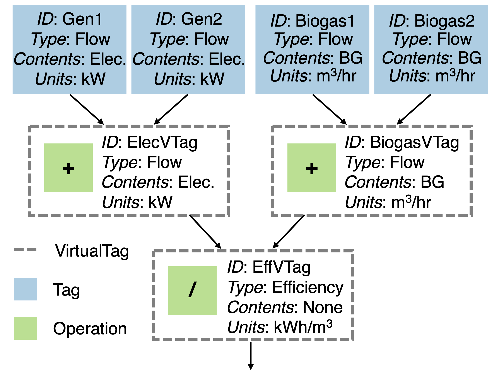

.. contents::

.. _advanced:

*****************
Advanced Features
*****************

.. _efficiency-curves:

Efficiency Curves
=================

Some attributes in PyPES are not static metadata. For example, a ``Pump`` may have an efficiency curve rather
than a single efficiency value. To define an efficiency curve, first define a function and then use 
``set_pump_curve()`` to set the ``pump_curve`` attribute to that function. ``thermal_efficiency``
and ``electrical_efficiency`` of ``Cogeneration`` and ``Boiler`` objects can be similarly defined.

.. code-block:: python

    from pype_schema.node import Pump
    from utils import parse_quantity, PumpType, ContentsType

    min_flow = parse_quantity(0, "gpm")
    max_flow = parse_quantity(1000, "gpm")
    avg_flow = parse_quantity(750, "gpm")
    elevation = parse_quantity(10, "m")
    horsepower = parse_quantity(100, "hp")

    def efficiency_curve(flowrate):
        return - (flowrate ** 2)

    pump = Pump(
        "PumpA",
        ContentsType.UntreatedSewage,
        ContentsType.UntreatedSewage,
        min_flow,
        max_flow,
        avg_flow,
        elevation,
        horsepower,
        1, 
        pump_type=PumpType.VFD
    )
    pump.set_pump_curve(efficiency_curve)

Currently, only static efficiency values are supported in the JSON format, but the long-term plan is to
support dictionaries (through interpolation) and lambda functions.

.. _algebraic-mode:

Algebraic Mode
==============

“Algebraic” mode involves the combination of operations are separated into binary (e.g., “+” or “-”) and unary (e.g., “∼” or “»”). 
Due to the closure of binary and unary operations, it is possible to recursively combine tags in any configuration the user desires. 
This allows for complex new data streams to seamlessly be integrated into system models. 

As an example, the figure below shows efficiency calculated by ``VirtualTag`` ("EffVTag"), 
which is composed of two ``VirtualTag`` objects ("ElecVTag" and "BiogasVTag") combined with the ``/`` operator. 
``VirtualTag`` objects "ElecVTag" and "BiogasVTag" are each a composition of two real-world sensor measurements using the ``+`` operator.

        The efficiency is calculated by ``VirtualTag`` ("EffVTag"), 
        which is composed of two ``VirtualTag`` objects ("ElecVTag" and "BiogasVTag") combined with the ``/`` operator. 
        ``VirtualTag`` objects "ElecVTag" and "BiogasVTag" are each a composition of two real-world sensor measurements using the ``+`` operator.

An example of how to define all the potential attributes in algebraic mode is available in 
`wrrf_sample.json <https://github.com/we3lab/pype-schema/tree/main/pype_schema/data/wrrf_sample_algebraic.json>`_.
A full table of supported algebraic operations can be found below.
Proofs of operator closure will be published along with the PyPES manuscript, which is currently under peer review.

.. table:: A list of all operations, their type (unary, binary, or constant), and a description of the computation performed by each.

    +-----------+-----------------+---------------------------------------------------------------------------------------------------+
    | Operation | Type            | Description                                                                                       |
    +===========+=================+===================================================================================================+
    | noop      | Unary operator  | No operation. Useful when skipping a tag in a list of unary operations                            |	
    +-----------+-----------------+---------------------------------------------------------------------------------------------------+
    | delta     | Unary operator  | Input[t] - input[t-1] for t in 1,…,T                                                              |
    +-----------+-----------------+---------------------------------------------------------------------------------------------------+
    | <<        | Unary operator  | Shift all data to the left one timestep, so that the first timestep will be deleted from the data |
    +-----------+-----------------+---------------------------------------------------------------------------------------------------+
    | >>        | Unary operator  | Shift all data to the right one timestep, so that the last timestep will be deleted from the data |
    +-----------+-----------------+---------------------------------------------------------------------------------------------------+
    | \-        | Unary operator  | Unary negation                                                                                    |
    +-----------+-----------------+---------------------------------------------------------------------------------------------------+
    | ~         | Unary operator  | Boolean negation. If numerical data, all nonzero values are changed to 0 and zeros to 1           |
    +-----------+-----------------+---------------------------------------------------------------------------------------------------+
    | \+        | Binary operator | Addition                                                                                          |
    +-----------+-----------------+---------------------------------------------------------------------------------------------------+
    | \-        | Binary operator | Subtraction                                                                                       |
    +-----------+-----------------+---------------------------------------------------------------------------------------------------+
    | \*        | Binary operator | Multiplication                                                                                    |
    +-----------+-----------------+---------------------------------------------------------------------------------------------------+
    | /         | Binary operator | Division                                                                                          |
    +-----------+-----------------+---------------------------------------------------------------------------------------------------+
    | value     | Constant        | A value that is constant at all timesteps                                                         |
    +-----------+-----------------+---------------------------------------------------------------------------------------------------+
    | units     | Constant        | Dimensionality (e.g., cubic meters or kilowatts)                                                  |
    +-----------+-----------------+---------------------------------------------------------------------------------------------------+

.. _custom-mode:

Custom Mode
===========

Where algebraic mode combines tags with a fixed set of operators, custom mode lets a ``VirtualTag`` apply any
calculation that can be written as a single lambda expression, given as a string:
 
.. code-block:: python
 
    "lambda flow, power: (power / flow).rolling(3).mean()"
 
Every expression is validated before it is built, by ``validate_custom_operation()`` and
``build_custom_operation()`` in ``pype_schema.operations``:
 
.. list-table::
   :header-rows: 1
   :widths: 25 75
 
   * - Raised
     - When
   * - ``ValueError``
     - The expression uses something that is not allowed, or is too large.
   * - ``SyntaxError``
     - The string is not valid Python.
   * - ``TypeError``
     - The operation is not a string.
 
Trust Model
-----------
 
Operations should come from the developer who created the file, or another trusted party. The checks stop
accidents and make a tampered file hard to turn into arbitrary code execution; they are **not** a substitute for
process-level isolation:
 
* Only the syntax and the names and attributes an expression can touch are restricted. CPU time and memory used
  while the expression runs are not (``9**9**9`` is valid, and so is ``[0] * 10**10``).
* An operation may modify the data passed to it in place (for example ``inplace=True`` or ``out=``). This is
  deliberate: it is a side effect on the caller's data, not a way around the restrictions, so do not assume your
  inputs are unchanged afterwards.
 
What an Expression Can Use
--------------------------
 
**Syntax.** Allowed: arithmetic, bitwise, comparison and boolean operators; calls with keyword arguments;
indexing and slicing; list, tuple, dict and set displays; list, set and dict comprehensions and generator
expressions; conditional expressions; nested lambdas. Not allowed: statements, assignment expressions (``:=``),
f-strings, ``await`` and ``yield``, default values for lambda parameters, and comprehension targets that are not
plain names (``[0 for np.sum in x]`` would rebind a library function). Expressions of more than 100,000
characters or 50,000 syntax nodes are rejected. Validation does not use the Python call stack, so deeply nested
expressions, such as a sum of several hundred terms, are fine.
 
**Names.** An expression can refer to its own parameters, comprehension variables, the library names below, and
these builtins: ``abs``, ``all``, ``any``, ``bool``, ``dict``, ``divmod``, ``enumerate``, ``filter``, ``float``,
``int``, ``len``, ``list``, ``map``, ``max``, ``min``, ``pow``, ``range``, ``reversed``, ``round``, ``set``,
``sorted``, ``str``, ``sum``, ``tuple``, ``zip``. Each only computes on the values it is given. The other
builtins are left out because they reach around the attribute allow-list: they import modules or run code, touch
files and input, look an attribute up from a string, or expose classes and namespaces. Any other name is
rejected, and so is any name or attribute that starts with an underscore, because that is how an expression
would walk to an object's internals (for example ``__class__``).
 
**Libraries.** ``np`` (``numpy``), ``pd`` (``pandas``), ``sp`` (``scipy``) and ``math`` can only be used as
prefixes, and only for members on the allow-list. A library or submodule cannot be used as a value (``f(np)``,
``[np]``, a bare ``np.linalg``), which keeps a module object from being passed around.
 
.. code-block:: python
 
    "lambda x: np.sqrt(x)"                  # fine
    "lambda x: sp.stats.zscore(x)"          # fine: submodules work as prefixes too
    "lambda x: x.apply(np.sqrt)"            # fine
    "lambda x: np.load('data.npy')"         # rejected: not on the allow-list
    "lambda x: pd.read_csv('data.csv')"     # rejected: not on the allow-list
 
**Methods and attributes** of ordinary objects (a ``Series``, ``DataFrame``, array, string, and so on) are
allowed by name, from a generated list. ``x.diff()``, ``x.rolling(3).mean()``, ``x.iloc[0]`` and
``x.str.upper()`` are fine; ``x.to_csv(...)``, ``x.query(...)``, ``x.eval(...)``, ``x.plot()`` and
``x.__class__`` are rejected.
 
**Guarded methods.** ``apply``, ``agg``, ``aggregate`` and ``transform`` look an attribute up by name when given
a string (``x.agg("to_csv")`` would call ``x.to_csv()``), which would bypass that list. They are only allowed
when called directly, with something whose method name is visible and checked. The argument may be:
 
* a lambda,
* a library function, such as ``np.mean``,
 
* a builtin, such as ``abs``,
* a string literal that names an allowed method, such as ``"sum"``,
 
* a list or tuple of those, or a dict whose keys are literal labels and whose values are those.
 
.. code-block:: python
 
    "lambda x: x.apply(lambda v: v + 1)"                    # fine
    "lambda x: x.agg(['sum', np.mean])"                     # fine
    "lambda x: x.agg({'a': np.mean, 'b': ['min', 'max']})"  # fine
    "lambda x: x.agg('to_csv')"                             # rejected: not an allowed method
    "lambda x: x.agg('to_' + 'csv')"                        # rejected: name built at runtime
    "lambda x: map(x.agg, ['sum'])"                         # rejected: method passed as a value
    "lambda x, f: x.apply(f)"                               # rejected: the function is not visible
    "lambda x: x.agg(total=('a', np.sum))"                  # rejected: named aggregation
 
``*`` and ``**`` arguments to these methods are also rejected.
 
Maintaining the Allow-Lists
---------------------------
 
What an expression can reach is defined by a generated block at the bottom of ``operations.py``, between the
``BEGIN GENERATED ALLOW-LISTS`` and ``END GENERATED ALLOW-LISTS`` markers. It defines:
 
``ALLOWED_MODULE_MEMBERS``
    What can be reached through ``np``, ``pd``, ``sp`` and ``math``, and their submodules.
 
``ALLOWED_ATTRIBUTES``
    Attribute names allowed on ordinary objects.
 
``GUARDED_METHODS``
    The methods that need the special handling described above.
 
``pype_schema/scripts/generate_allowlist.py`` writes the block from the public API of the installed numpy,
pandas, scipy and math, and removes everything it judges dangerous (below). The result is frozen and
default-deny, so a function added by a newer library version is unreachable until the generator is re-run and
the diff is reviewed. ``pype_schema/scripts/allowlist_report.md`` lists everything that was excluded, and why.
Do not edit the block by hand: ``test_generated_block_has_not_been_edited_by_hand`` fails if it differs from
what the generator writes.
 
.. list-table::
   :header-rows: 1
   :widths: 15 85
 
   * - Category
     - Excluded because it
   * - IO
     - reads or writes files, URLs, the clipboard, databases, or pickles
   * - EVAL
     - evaluates code or expression strings
   * - DISPATCH
     - turns a string into a function or attribute lookup (``df.agg("sum")``); the four methods
       above are allowed only in the guarded form, the rest are excluded
   * - STATE
     - changes process-wide state: configuration, the global random seed, registries, mutable
       module-level containers
   * - NATIVE
     - exposes raw memory or native-code interfaces
   * - ENV
     - reveals the environment: paths, build configuration, versions, source
   * - OTHER
     - is not computation on data, or has not been reviewed: plotting, testing, typing,
       deprecated aliases, internals
 
.. code-block:: bash
 
    python pype_schema/scripts/generate_allowlist.py          # regenerate, then review the diff
    python pype_schema/scripts/generate_allowlist.py --check  # change nothing; for CI
 
The result depends on the environment it runs in, so generate in one canonical environment:
 
* The Python version changes the ``math`` members and the methods of built-in types.
* The versions of numpy, pandas and scipy decide which functions exist. A CI matrix usually resolves different
  versions for each Python.
 
* Optional packages count too. If one is installed, whatever it adds to numpy, pandas or scipy is listed like
  everything else. numexpr is the known case: once installed, importing pandas makes it add ``numpy.expm1x``, an
  alias of ``numpy.expm1``.
 
The block records the Python, numpy, pandas and scipy versions in a ``Generated with ...`` comment, but not
optional packages. Run ``--check`` in **one** CI job, with the same Python minor version, pinned libraries and
optional packages; the rest of a CI matrix runs pytest only.
 
.. list-table::
   :header-rows: 1
   :widths: 15 85
 
   * - Exit code
     - Meaning
   * - 0
     - The block is up to date.
   * - 1
     - Regenerating would change it: new library API to review, or a different set of optional
       packages. The output lists the names that would be added (``+``) or removed (``-``).
   * - 2
     - This is not the environment the block was generated in, so the two cannot be compared.
       This is a CI configuration problem, not drift.
 
``--check`` only reads, so it also works on an installed copy of the package. Rewriting an installed copy is
refused unless ``--force`` is passed.
 
To change a decision, edit the rules at the top of the generator and re-run it:
 
``KEEP``
    Allow a library member that a rule would exclude.
 
``KEEP_ATTRS``
    Allow an attribute name that a rule would exclude.
 
``EXPLICIT and NAME_RULES``
    Exclude a name, with a category and a reason.
 
When reviewing a diff, look for names that read or write files, evaluate strings, turn a string into an
attribute lookup, change global state or touch raw memory, and for names that another package has leaked into
the library. For example, ``pandas.NamedFunc`` has the same signature as ``NamedAgg``, which takes a function
name as a string, so it is excluded in the same way.
